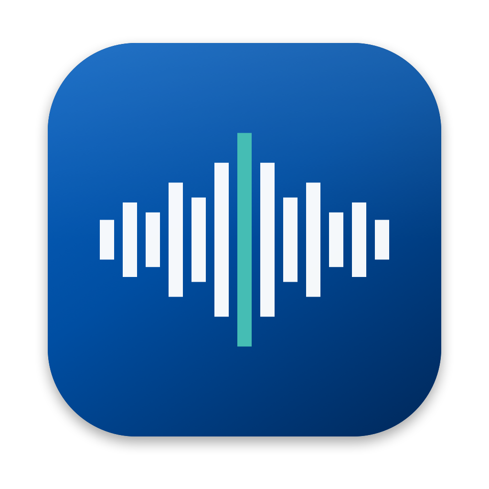

# YuVoice

macOS 選單列的語音輸入工具。按一下快捷鍵講話，再按一下，整理好的文字就會打進游標所在的輸入框。LINE、Slack、Mail、瀏覽器、Claude、ChatGPT、備忘錄都能用。



## 會幫你做什麼

- 轉寫：用 OpenAI 的 gpt-transcribe，中英夾雜也聽得懂。
- 整理：交給 Claude Haiku 5.5，去掉「嗯、那個、然後然後」，講到一半改口只留後面的版本，講「第一、第二」自動排成條列，中文一律用台灣正體字與台灣用語。
- 依 app 調語氣：聊天口語、Email 正式、給 AI 的指令精準、筆記精簡。
- 改寫選取的字：選起一段字再講「改正式一點」「縮短」「翻成英文」，選取的字會直接換掉。
- 專有名詞：人名、品牌、術語加進詞彙表，聽錯也會改回正確寫法。括號可以寫常被聽成的樣子，例如「GitHub（get hub）」。
- 預先轉寫：講完停頓的時候就先送出，按下結束後通常 1 秒內貼上。

講完到貼上大約 2 到 3 秒。

## 安裝

1. 到 [Releases](https://github.com/hausco/yuvoice/releases/latest) 下載 `YuVoice-版本.dmg`。
2. 打開 DMG，把 YuVoice 拖進「應用程式」。
3. 打開 YuVoice，照設定引導完成四步：
   - 允許麥克風。
   - 在「輔助使用」打開 YuVoice（偵測快捷鍵與貼上文字用）。
   - 要用 Fn 鍵的話，到「系統設定 → 鍵盤」把「按下 🌐 鍵時」改成「不做任何事」。
   - 貼上 OpenRouter 金鑰。

需要 macOS 14 以上，Apple Silicon 與 Intel 都能用。

## OpenRouter 金鑰與費用

YuVoice 透過 [OpenRouter](https://openrouter.ai) 呼叫 AI 模型，費用由你自己的 OpenRouter 帳戶支付，YuVoice 不另外收費。

1. 到 [openrouter.ai/settings/keys](https://openrouter.ai/settings/keys) 註冊並建立金鑰（`sk-or-` 開頭）。
2. 在 OpenRouter 儲值，幾美元可以用很久：一天講 1 小時，轉寫加整理一個月約 3 到 8 美元。
3. 把金鑰貼進 YuVoice 的設定引導或「設定 → 金鑰與模型」。YuVoice 會先實際測一次，通過才存進 macOS 鑰匙圈。

## 使用方式

- 按一下 Fn 開始，講完再按一下結束。按住超過 1 秒再放開也會結束。
- 錄音時螢幕下方會出現聲波。點 ✕ 或按 Esc 取消；取消後 4 秒內可以按「復原」照樣送出。
- 也可以在「設定 → 一般」改用滑鼠中鍵或自訂組合鍵。
- 選單列圖示的選單有「貼上上一段」「貼上上一段原文（未整理）」「歷史紀錄」。

## 隱私

- 錄音與游標附近的文字（前 400 字、後 200 字、選取的字）會送到 OpenRouter，再轉給模型供應商（OpenAI、Anthropic）處理。
- 密碼欄位不讀取。
- 歷史紀錄、詞彙表、設定只存在你的 Mac：`~/.yuvoice/`。
- 金鑰存在 macOS 鑰匙圈，不寫進任何檔案。

## 實驗功能：與 Typeless 同步詞庫

有裝 Typeless 的話，可以在「設定 → 實驗功能」打開。YuVoice 會讀 Typeless 在本機的字典快取，把詞併進詞彙表；YuVoice 有、Typeless 沒有的詞會寫成 CSV，在 Typeless「字典」頁按「匯入 CSV」就能加進去。不需要 Typeless 的帳號密碼，但 Typeless 改版時可能失效。

## 從原始碼編譯

只需要 Xcode Command Line Tools，不需要 Xcode 專案。

```bash
./build.sh            # 編譯、簽章、安裝到 /Applications 並開啟
./release.sh          # 發佈：Developer ID 簽章、公證、做成 DMG（需要 Apple Developer 帳號）
```

進階設定可以直接改 `~/.yuvoice/` 裡的檔案：`config.json`（設定）、`vocabulary.txt`（詞彙表）、`prompt.md`（整理規則），改完不用重開。

## 授權

MIT。整理規則改寫自 [jarvis-voice](https://github.com/urusaqqrun/jarvis-voice)（MIT）。
